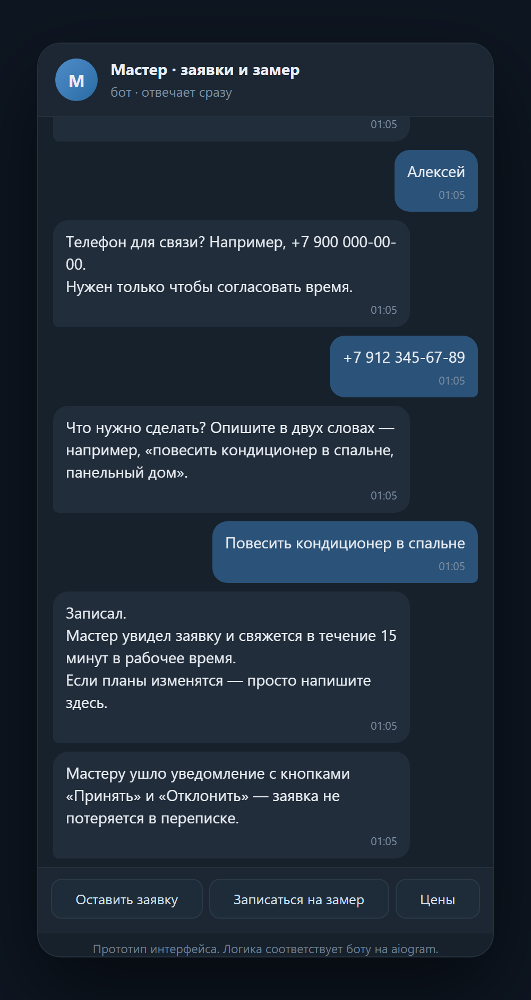

# Telegram-бот заявок и записи на замер

Готовый бот для мастера или небольшой службы: принимает заявку, отправляет её владельцу
с кнопками «Принять» / «Отклонить», записывает клиента на свободный час.
Без базы данных, без платных сервисов, без внешних API. Python 3.10+, aiogram 3.



## Что здесь проверено

Автотест `selftest.py` поднимает настоящий `Dispatcher` и прогоняет сценарии на поддельной
сессии Telegram — токен и интернет не нужны, ничего никуда не отправляется.

Последний прогон: **17.11.2026, Python 3.12.2, aiogram 3.31.0 — 49 проверок из 49 пройдено**.
Повторить у себя: `python selftest.py` (лог пишется рядом с ботом, в репозиторий не входит).

Что именно покрыто:

- заявка целиком: имя → телефон → задача → карточка владельцу с номером заявки;
- отказ на мусорном телефоне и на имени из одной буквы;
- уведомление владельца не отправляется, если `ADMIN_ID` не задан, и клиент получает
  честное «уведомление не отправлено» вместо ложного обещания;
- запись на замер: 9 слотов на три дня, занятый час нельзя забронировать дважды
  (кнопка исчезает из меню, повторный клик отбивается предупреждением);
- кнопки владельца «Принять» / «Отклонить» и отказ постороннему пользователю;
- `/cancel` и переключение меню посреди заполнения формы;
- счётчики `/stats`.

Чего автотест не проверяет: реальную отправку в Telegram — для этого нужен токен.
Проверка токена без запуска бота:

```powershell
python bot.py --check
```

## Запуск за две минуты

1. Токен: в Telegram открыть [@BotFather](https://t.me/BotFather), команда `/newbot`.
2. Свой ID: написать [@userinfobot](https://t.me/userinfobot), он пришлёт число.
3. Запустить установщик и вписать два значения в открывшийся `.env`:

```powershell
start.bat
```

Вручную то же самое:

```powershell
python -m venv .venv
.\.venv\Scripts\Activate.ps1
pip install -r requirements.txt
copy .env.example .env      # вписать BOT_TOKEN и ADMIN_ID
python bot.py
```

4. Открыть своего бота в Telegram, нажать `/start`.

## Команды

| Команда | Что делает |
|---|---|
| `/start` | приветствие и меню на кнопках |
| `/help` | что умеет бот |
| `/cancel` | выйти из заполнения формы |
| `/stats` | заявок сегодня, всего заявок, людей в боте, свободных слотов (только владельцу) |

## Что менять под клиента

| Что | Где |
|---|---|
| Цены | `prices()` в `bot.py` |
| Телефон и часы работы | `contact()` |
| Свободные часы | `slots_for_days()` — сейчас три дня по три времени |
| Проверка телефона | регулярка `PHONE_RE` |
| Кнопки меню | `MAIN_KB` |
| Тексты шагов формы | обработчики `form_*` и `booking_*` |

## Структура

```
bot.py            бот: меню, заявка, запись, кнопки владельца, /stats
selftest.py       автотест без токена (49 проверок)
demo.html         прототип интерфейса в браузере, открывается двойным кликом
demo-chat.png     скриншот живой переписки
start.bat         установка окружения и запуск в один клик (Windows)
.env.example      шаблон настроек
requirements.txt  aiogram, python-dotenv, gspread
```

`demo.html?auto=1` проигрывает диалог сам — так снят скриншот.

## Ограничения

- Заявки и брони живут в памяти процесса: после перезапуска список пуст. Для боевого
  бота заменить на sqlite — структура `REQUESTS` к этому готова.
- Один владелец: `ADMIN_ID` — одно число, несколько мастеров не поддерживаются.
- Нет вебхука и деплоя: бот работает, пока запущен процесс. Круглосуточная работа —
  отдельная настройка (сервер, systemd, Docker).
- Запись в Google Sheets включается только при заданных `GSHEET_ID` и `credentials.json`;
  без них шаг молча пропускается.

## Лицензия

MIT — см. [LICENSE](LICENSE).
